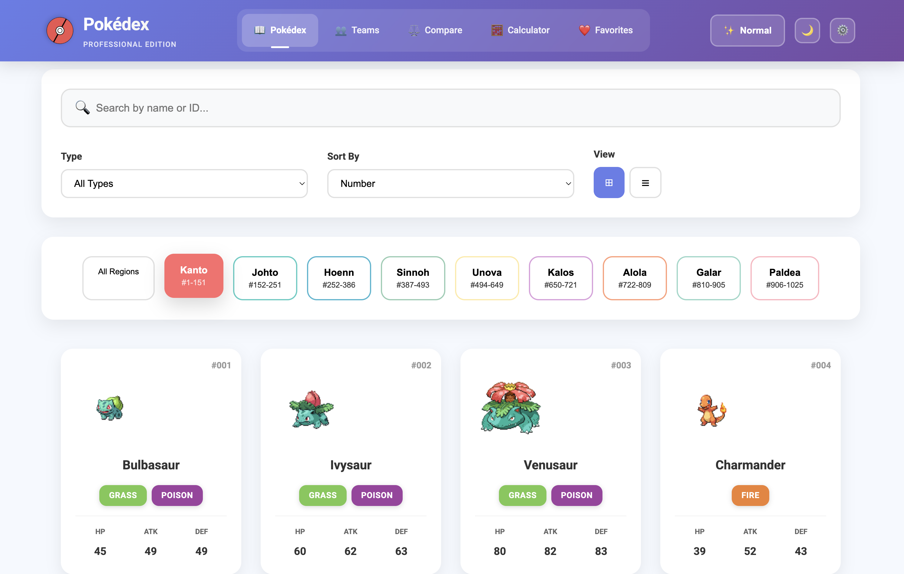

# Interactive Pokédex

A Pokédex web app built with React and TypeScript on top of the public [PokéAPI](https://pokeapi.co/).



**[▶ Live demo](https://fredbourouliou.github.io/interactive-pokedex/)**

## Features

- **Browse all 1025 Pokémon** (Generations I–IX) or one region at a time, 48 cards per page with a "Load more" button.
- **Search and filter** across the whole selected range: search by name or ID, filter by type, sort by number, name or type, grid or list view.
- **Shiny toggle** in the header to switch card sprites to their shiny variant.
- **Detail page** per Pokémon: artwork (animated sprite when available), types, generation, Pokédex description, height, weight, abilities, base-stat bar chart and type chart.
- **Comparison**: put up to 6 Pokémon side by side with their base stats (the picker currently offers the first 20 Kanto Pokémon).
- **Damage calculator**: simplified damage formula with type effectiveness, STAB, critical hits, weather and terrain modifiers.
- **Teams**: create, delete, import and export named teams (JSON, stored in `localStorage`). Adding Pokémon to a team is not implemented yet.
- **Favorites**: list, filter, import and export a favorites file (JSON, stored in `localStorage`). There is no "add to favorites" button in the UI yet.

## Tech stack

- React 18, TypeScript, Vite 5
- React Router 6 (`HashRouter`, so deep links work on GitHub Pages)
- Framer Motion (animations), Recharts (charts)
- Axios / `fetch` against PokéAPI
- Plain CSS
- Playwright for end-to-end tests, GitHub Actions for CI and Pages deployment

## How it works

- `src/main.tsx` mounts `App` inside a `HashRouter`; `App` maps routes to the components in `src/components/`.
- The list (`EnhancedPokemonList`) fetches a lightweight index (id + name) of the selected range in one request, then fetches full details only for the cards on screen, in batches, and caches them. Type filtering and sorting use PokéAPI's `/type/{name}` endpoint, so they apply to the whole range.
- Generation metadata (regions, National Dex ranges) lives in `src/constants/generations.ts`.
- Teams and favorites are stored in `localStorage`; there is no backend.

## Run locally

Requires Node.js 20+.

```bash
npm ci
npm run dev        # http://localhost:5173/interactive-pokedex/
npm run build      # type-check and production build into dist/
npm run preview    # serve the production build
```

## Tests

End-to-end tests use Playwright. PokéAPI is mocked in the tests (`e2e/utils/pokeapi-mock.ts`), so they do not depend on the network.

```bash
npx playwright install          # once, downloads the browsers
npm run test:e2e                # builds the app, serves it and runs the suite
E2E_LIVE=1 npx playwright test e2e/live.spec.ts --project=chromium   # optional smoke test against the real PokéAPI
```

CI runs the suite on Chromium, Firefox and WebKit for every push and pull request to `main`.

## License

[MIT](LICENSE) © 2025 Frédéric Bourouliou

This is a non-commercial fan project. Pokémon and all related names are trademarks of Nintendo, Creatures Inc. and GAME FREAK Inc. Pokémon content is © Nintendo, Creatures Inc., GAME FREAK Inc. This project is not affiliated with or endorsed by any of these companies. Data comes from [PokéAPI](https://pokeapi.co/).
